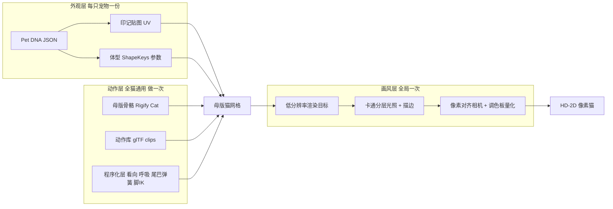

# 喵汪小镇：猫猫还原新技术方案（3D 骨骼母版 + 实时像素化）

## 1. 为什么卡住了

之前三个阶段（Canvas 几何拼猫、18 槽水彩/Spine、像素帧序列）的共同问题是：**外观和动作绑在一起生产**。每只猫的印记都要在每一帧里重画或重拼，工作量 = 动作数 x 宠物数 x 帧数，动作越多返工越多。2D 骨骼对像素画也不成立：像素图旋转/形变会产生糊边和混合像素，水彩形变会破相，这些都是已踩过的坑。

**核心思路：把「长什么样」「怎么动」「什么画风」拆成三层，各做一次、自由组合。** 工作量变成 动作数 + 宠物数。




## 2. 三层各自怎么做

### 外观层：印记长在模型表面，不长在帧上

- 一只低模母版猫（约 3k-6k 三角面），**UV 不做左右镜像**。这是五印记非对称规范能成立的硬前提：右嘴套焦糖块、左鼻下纯白、左腹云斑这些都只是同一张贴图上的不同区域，自动跟随所有动作。
- 印记贴图按「最终像素尺寸」设计：一个贴图像素大约对应屏幕上一个像素，避免出现模糊的中间色。
- 体型差异用 ShapeKeys（形态键）：头圆度、胖瘦、腿长、耳朵大小、尾长/尾蓬松度、脸颊毛量。
- Pet DNA 示例（只是数据，不再是一套图）：

```json
{
  "id": "mimi",
  "shape": { "headRound": 0.7, "weight": 0.4, "earSize": 0.5, "tailFluff": 0.8 },
  "texture": "pets/mimi/coat.png",
  "eyes": { "atlas": "eyes/amber.png", "irisColor": "#C98A2E" },
  "personality": { "idleWeights": { "groom": 0.3, "loaf": 0.4, "stretch": 0.1 } }
}
```

### 动作层：骨骼动作做一次，所有猫通用

- Blender 自带的 Rigify 有现成的 Cat 骨架模板（metarig），直接生成可动画的绑定，免费。
- 第一批动作片段：待机呼吸、走、小跑、坐下、揣手手（踩奶）、歪头、舔毛、伸懒腰、蜷睡。每个片段都是导出到 glTF 的一条动画轨，新增一个动作只需在母版上做一次。
- 程序化层（运行时叠加，让猫显得活泼，零美术成本）：头部看向玩家/物体、随机耳朵抖动、尾巴弹簧骨骼、脚部贴地 IK、呼吸叠加、动作之间的混合过渡。
- 「逛仙侠/温馨小镇随机闲逛」的行为只是一个状态机，按 `personality.idleWeights` 随机挑选动作，同一套动作库就能表现出不同性格。

### 画风层：实时像素化，不是事先烘焙成帧

- 场景渲染到低分辨率目标（例如 480x270），最近邻放大到屏幕。
- 3-4 档色阶的卡通光照 + 基于深度/法线的描边 + 可选调色板量化。
- 相机按像素网格对齐，避免移动时像素闪烁。这是 t3ssel8r 风格「3D 像素画」的标准做法；Dead Cells 也是用 3D 模型输出像素角色。
- **脸部单独处理**：眼睛和嘴用手绘像素贴图集（睁眼/眨眼/眯眼开心/困/惊讶），贴在脸部网格上切换，不靠网格形变。这样神态始终清晰，直接解决之前「面部神态像纸偶」的问题。
- 毛茸感：脸颊、胸毛、尾巴用少量插片（mesh cards）做蓬松轮廓，在像素尺度下读出「毛茸茸」的剪影即可，不追求毛发细节，和 `full_idle_pixel_v1`「远看神似、不深究毛发细节」的结论一致。

## 3. 技术选型（全部免费/开源）

- 建模/绑定/动作：Blender + Rigify（免费）。起步模型可选：自己建低模，或用开源 Hunyuan3D-2 / CC0 动物资源生成基础形状后重拓扑。
- 运行时：**推荐 three.js + TypeScript**。平台未定时它覆盖面最广：H5 直接跑，微信小游戏可通过适配层运行，App 可用 WebView/Capacitor 套壳。备选是 Godot 4（App 端体验更好，但小程序支持弱）。
- 像素贴图/眼睛贴图集：LibreSprite（免费）或 Aseprite。
- 资源格式：glTF/GLB（网格 + 骨骼 + 动画 + 形态键一个文件带走）。

## 4. 技术验证（先证明可行，再铺量）

目标：用一只真实宠物（五印记那只）+ 5 个动作，做一个可交互的网页 demo。

- 通过门槛 1：主人 3 秒内认出「这是我家咪咪」（印记、体型、神态）。
- 通过门槛 2：给同一只猫新增第 6 个动作时，**不需要碰任何这只猫专属的资源**。
- 通过门槛 3：换一只新猫只需要提供一张贴图和一份 DNA JSON，不需要改任何动作。
- 任何一条不通过，就在这个阶段调整，不进入量产。

## 5. 主要风险与应对

- 猫咪动作制作成本：没有现成的猫动作捕捉。应对：先做 5 个核心动作，参考真猫视频逐帧对照 K 帧；其余活泼感尽量交给程序化层。
- 像素闪烁/抖动：靠像素对齐相机 + 固定贴图像素密度解决，验证阶段重点检查。
- 印记绘制门槛：初期由美术在 Blender 里直接在 3D 模型上绘制贴图；后续再做「照片辅助投影印记」的工具，不放进验证阶段。
- 3D 剪影不够萌：母版比例按 Q 版设计（大头、短腿、圆身），由 ShapeKeys 在 Q 版范围内微调，不追求写实比例。

## 6. 交付物

- `喵汪小镇/docs/cat-tech-architecture.md`：本方案的正式技术文档（三层架构、DNA 规范、UV 与贴图像素密度规范、动作清单）。
- `喵汪小镇/prototype/`：three.js 验证 demo（母版猫 GLB + 像素化渲染管线 + 动作状态机 + DNA 加载）。
- `喵汪小镇/assets/cat_base.blend`：母版猫源文件。

