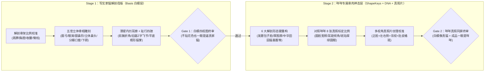

# 《喵汪小镇》3D 猫咪母版解剖重塑与「咩咩」精修规范

> **版本**：v1.0（2026-10-27 制定）
> **核心铁律**：**先是一只逼真的猫（Stage 1：写实家猫解剖母版 `Basis`），再是一只逼真的咩咩（Stage 2：咩咩专属形态键 + 多视角真照片纹理层）**。严禁在“椭球/胶囊拼装玩具感底座”上直接堆叠贴图或参数敷衍交差。

---

## 一、 现状根因诊断：为什么当前 `cat_base.glb` 仍有“充气玩具/面团感”？

通过对当前 `prototype/tools/blender/build_base.py` 生成的网格进行 Blender 解剖截面审计，定位出 **7 项几何结构根因**：

| 编号 | 部位 | 当前 `build_base.py` 的实现缺陷 | 视觉后果 |
| :--- | :--- | :--- | :--- |
| **G-01** | **头颅与额鼻转折（Stop）** | `part_head` 是略压扁的椭球（`rx=0.282, ry=0.272, rz=0.252`），`part_muzzle` 是直接插在正前方的另一个小椭球，经 `Voxel Remesh (0.014)` 后融合成圆滑鼓包，**缺少猫科动物标志性的眉弓、眼窝浅凹、鼻梁鼻骨平面与额鼻转折（Stop 台阶）**。 | 侧面看像圆球上粘了个球形鼻子，没有真猫的鼻梁骨与面部立体转折面。 |
| **G-02** | **口套（Whisker Pads）与下颌** | 嘴套与上唇胡须垫（Whisker Pads）没有形成左右分瓣的饱满花生状/W形结构，下巴（Chin）与下颌骨（Mandible）退化成圆弧底面。 | 正面看嘴套像贴片，缺少真猫饱满立体的口套肉垫和清晰的下巴颏。 |
| **G-03** | **耳廓（Pinna）厚度与耳窝** | `part_earL/R` 是闭合厚圆锥（`rb=0.128`），虽然前后扁平比不同（`0.38 vs 0.54`），但**没有内凹的耳窝（Concha）与薄耳缘（Helix）**，耳根直接插在球形脑壳上。 | 耳朵像两只实心厚牛角/馒头角，缺少真猫耳廓“外凸内凹、边缘薄透、耳根自然延展”的灵动感。 |
| **G-04** | **躯干胸腹线与肩胛/骨盆骨点** | `part_body` 是接近圆柱形的椭球（`rx=0.232, ry=0.236`），仅靠微弱高斯项（`0.026`）模拟背线，**缺少前肢上方的肩胛骨隆起（Withers）、深胸腔（Deep Brisket）、后腹收腰（Abdominal Tuck）以及圆润的后臀骨盆转折（Croup）**。 | 躯干像一根粗细均匀的香肠/胶囊，看不出猫科动物富有弹性的脊柱S线与肩臀肌肉块面。 |
| **G-05** | **前肢解剖（肩—肘—腕—掌）** | `part_fLegL/R` 几乎是垂直向下的直圆管（`leg_z_off` 最大偏移仅 `0.012~0.028`），**缺少真猫前肢“肩部前倾→肘部向后收拢贴胸→前臂垂直向下→腕关节（Carpus）微折→猫爪向前平铺”的解剖折线**。 | 四条腿像插在肚子下面的四根直木桩，站立和迈步时缺少猫腿的关节结构感。 |
| **G-06** | **后肢解剖（大腿—膝—跗关节/飞节—跖骨—爪）** | 猫是典型的**趾行动物（Digitigrade）**：大腿（Femur）向前下伸出膝盖（Stifle），小腿（Tibia）向后下斜伸至高高抬起的脚后跟/飞节（Hock / Tarsus，`y ≈ 0.19`），再由跖骨向下连接后爪。当前后肢 `leg_z_off` 偏移仅 `±0.022`（约 `2cm`），飞节折角几乎看不见，大腿股四头肌与臀肌也没有和躯干后侧融合。 | 后腿和前腿一样像直筒柱子，完全没有猫后腿标志性的“Z 字形”蓄力弹跳结构。 |
| **G-07** | **猫爪（Paws）与指垫形态** | 爪部只是腿管末端的半球封顶（`paw_r = 0.064`），底面未严格压平贴地，前侧没有四个趾头（Digital pads）微鼓的楔形猫掌轮廓。 | 脚掌像圆头火柴棒，接地感弱。 |

---

## 二、 两阶段精修总体架构（先真猫，后咩咩）

为了彻底杜绝“在错误几何底座上打补丁”，3D 造型精修严格拆分为 **两个解耦阶段**，每阶段独立验收：

---

## 三、 Stage 1 详细规范：写实家猫解剖母版（`Basis` 中性真猫）

Stage 1 的目标是让 `cat_base.glb` 的 `Basis`（所有形态键为 `0` 时的基础网格）**在不贴任何花色贴图的纯素白模（Clay Render）状态下，从正视、侧视、45° 视、俯视四个角度看，都是一只结构严谨、比例逼真的成年中华田园家猫**。

### 3.1 全局比例基准（Three.js 坐标系：地面 `y = 0`，朝向 `+Z`，左侧 `+X`）

以成年家猫标准站立姿态（略带 Q 版亲和力的写实比例，头高比约 `1 : 3.2`，既保留 HD-2D 远景可读性，又具备真实解剖骨相）：

- **地面基准**：四掌肉垫底面严格贴合 `y = 0.000 ~ 0.008` 平面（绝不悬空或陷入地下）。
- **鬐甲/肩胛最高点（Withers）**：`y = 0.68, z = 0.24`（高于背部中段）。
- **背部鞍区最低点（Thoracolumbar dip）**：`y = 0.65, z = 0.00`（自然的猫科柔韧背凹）。
- **十字部/骨盆隆起最高点（Croup / Sacrum）**：`y = 0.69, z = -0.24`（后臀圆润隆起，略高于肩峰）。
- **胸骨最低点（Deep Brisket）**：`y = 0.34, z = 0.22`（胸腔深而饱满）。
- **后腹收腰最高点（Abdominal Tuck）**：`y = 0.39, z = -0.16`（腹线从胸腔向后自然上收，形成真实猫腹曲线）。

### 3.2 头部、面部骨相与耳廓解剖要求

1. **颅骨与额鼻转折（Cranium & Stop）**：
   - 额头（Forehead）圆润饱满，在双目连线上方（`y ≈ 0.93, z ≈ 0.72`）形成清晰的**眉弓（Brow ridge）与额鼻转折台阶（Stop）**。
   - 从眉心向下至鼻尖（`y = 0.84, z = 0.82`）伸出**平直微翘的鼻梁骨脊（Nasal bridge）**，鼻尖形成倒三角形的立体鼻头凸起（Nose leather），绝不能是模糊球面。
2. **眼窝（Eye Sockets）与颧弓（Zygomatic Arch）**：
   - 在左右眼锚点（`x = ±0.108, y = 0.895, z = 0.755`）处雕刻出**真实的浅凹眼窝平面（Orbital plane，法线朝前偏外约 `18°`）**，眼眶外下方由饱满的颧弓与腮帮承托，使眼部贴片或三维眼球自然嵌入眼窝，彻底告别“球面贴纸感”。
3. **分瓣口套（Bifurcated Whisker Pads）与下颌（Chin）**：
   - 鼻头下方左右两侧鼓起对称饱满的**花生形胡须垫（Whisker pads / Muzzle pads）**，正中留出清晰的人中浅沟（Philtrum）。
   - 口套下方收出清晰独立的**下巴颏（Chin / Mandible，`y ≈ 0.75, z ≈ 0.76`）**，侧面剪影呈现真实的“鼻尖—上唇口套—下巴颏—咽喉”四段式猫脸侧颜，而非单段圆弧。
4. **外凸内凹的真猫耳廓（Cupped Pinna）**：
   - 耳朵位于头顶两侧偏前（耳根中心 `x = ±0.125, y = 1.08, z = 0.62`），外耳缘（Outer helix）呈柔和弧线收向略圆润的耳尖，内耳缘较直。
   - **必须雕刻出前表面真实的耳窝凹槽（Concha cavity，深度 `0.025~0.035`）与薄耳廓边缘**，后表面呈圆润壳状（Convex back），彻底消除“实心牛角感”。

### 3.3 四肢趾行解剖结构（Digitigrade Limbs）与猫掌

1. **前肢（Forelimbs：肩胛 $\to$ 上臂 $\to$ 肘 $\to$ 前臂 $\to$ 腕 $\to$ 掌）**：
   - **肩胛与上臂（Shoulder / Humerus，`y ∈ [0.36, 0.56]`）**：与前胸侧壁自然融合，轴线从肩关节（`z = 0.33`）略向后下斜至肘部（`z = 0.27, y = 0.30`），表现真实的肱三头肌厚度。
   - **前臂与腕关节（Forearm / Carpus，`y ∈ [0.09, 0.30]`）**：从肘部向前下延伸至腕关节（`z = 0.31, y = 0.11`），前臂比上臂纤细精干。
   - **前掌（Forepaw，`y ∈ [0.00, 0.09]`）**：从腕关节向前伸出（掌心 `z = 0.35`），底面平整贴地，前端呈微宽的四趾椭圆形肉垫轮廓。
2. **后肢（Hindlimbs：臀股 $\to$ 膝 $\to$ 小腿 $\to$ 飞节/跗关节 $\to$ 跖骨 $\to$ 后爪）**：
   - **大腿股部（Thigh / Haunch，`y ∈ [0.34, 0.62]`）**：大腿根部宽厚（`rx = 0.105, rz = 0.155`），与骨盆臀部连为一体；大腿轴线从髋部（`z = -0.22`）**向前下方**斜伸至膝盖（Stifle，`z = -0.15, y = 0.33`）。
   - **小腿与飞节（Crus & Hock，`y ∈ [0.16, 0.33]`）**：从膝盖（`z = -0.15`）**明显向后下方**斜伸至高高突出的脚后跟/飞节（Hock，`z = -0.29, y = 0.17`），形成真猫标志性的后腿折角（折角深度 $\ge 0.12$ 单位，比旧版放大 5 倍以上）。
   - **后跖与后掌（Metatarsus & Hindpaw，`y ∈ [0.00, 0.17]`）**：从飞节（`z = -0.29`）向前下方落地至后掌（`z = -0.21, y = 0.00`）。
3. **尾巴（Tail）**：
   - 尾根（`y = 0.64, z = -0.44`）从十字部自然延伸，拒绝“插在屁股半腰上的棍子”；尾根较粗，沿自然下垂微翘的 S 形曲线（Catmull-Rom）平滑收细至圆润尾尖。

---

## 四、 Stage 2 详细规范：从「逼真的猫」到「逼真的咩咩」

在 Stage 1 写实家猫母版验收通过后，对照 `reference/miemie_photos/photo_1..8.jpg` 真照片，将咩咩区别于普通家猫的个体特征注入 **形态键（ShapeKeys）+ `mimi.json` 外观层**：

### 4.1 咩咩真照片骨肉特征提取表（对照 `photo_1..8.jpg`）

| 特征维度 | 咩咩真照片表现（视觉锚点） | 对应 3D 形态键 / 参数实现 |
| :--- | :--- | :--- |
| **脸型与腮帮** | 典型中华田园狸花白猫的**圆润包子脸**，两颊在眼眶下方至嘴角两侧有非常饱满的横向发腮弧度，但绝不遮挡鼻梁与下巴轮廓（`photo_1`, `photo_2`, `photo_6`）。 | `headRound = 0.55`（扩大颅顶与面中宽度）、`cheekFluff = 0.62`（定向外扩颧弓下方与两腮横向体积，保留正面鼻梁与侧面 Stop 转折）。 |
| **口套与阴阳脸** | 嘴套（Whisker pads）饱满微鼓，猫自身右侧（观察者左侧）嘴套有明显的暖褐/深棕阴阳斑，猫自身左侧嘴套及下巴雪白（`photo_1`, `photo_2`）。 | `muzzleSize = 0.52`（饱满花生形口套）+ 正脸关键点仿射投影高密度 UV 区（`128×64`）。 |
| **胸前围脖与微胖肚皮** | 坐姿与仰躺时胸前白毛蓬松厚实，腹部圆润饱满（尤其 `photo_4`, `photo_5` 仰躺露肚皮时，腰腹柔顺圆鼓，肚皮正中有独立暖橘圆斑）。 | `weight = 0.36`（定向增加胸前围脖厚度、侧腹圆润度与原始袋/垂腹弧度，**严禁把四肢脚腕一起拉粗**）。 |
| **耳型与耳距** | 中等偏圆润的三角形耳廓，耳距较宽（显脸圆），耳内透出浅粉肉色与白毛簇（`photo_1`, `photo_8`）。 | `earSize = 0.45`（微调耳高与外展倾角，保持内耳窝凹槽）。 |
| **尾巴蓬松度** | 环纹黑棕长尾，尾毛紧密饱满、尾尖黑棕圆润（`photo_3`, `photo_7`）。 | `tailFluff = 0.38`（沿尾椎法向均匀蓬松）。 |

### 4.2 6 大标准形态键（ShapeKeys）的解剖边界约束

为防止形态键破坏写实解剖结构，所有形态键在 `build_base.py` 中必须遵守以下硬约束：
1. **`weight`（体重/丰满度）严禁影响四肢下段（`y < 0.34`）与头部**：胖猫胖在胸腹、腰臀与围脖，前腕、脚踝与猫爪必须保持纤巧灵动。
2. **`headRound` 与 `cheekFluff` 严禁抹平鼻梁台阶（Stop）与眼窝**：发腮只向左右两侧（`±X`）与面颊前下侧扩展，鼻梁中轴线（`|x| < 0.04`）保持骨相清晰。
3. **五官锚点自动跟随**：`face.ts` 中 `eyeL / eyeR / mouth / whiskerL / whiskerR` 的形态键位移向量由 Blender 导出时精确采样对应顶点的 ShapeKey delta，确保无论怎么捏脸，眼睛、鼻头和胡须都 100% 贴合在眼窝与鼻尖表面。

---

## 五、 工程兼容性与零回归硬门禁（Engineering Invariants）

在升级 3D 网格造型时，以下底层工程契约 **100% 保持不变**，确保现有的 7 套动作（`idle, walk, sit, loaf, groom, stretch, belly`）、全部 3 只宠物（`mimi, juzi, nainiu`）及照片生成管线零破坏：

1. **单一流形水密网格（Single Watertight Manifold Mesh）**：
   - 导出前通过 Blender `Voxel Remesh` + `Laplacian/Surface Smooth` + 解剖特征精雕，确保全身骨骼肌肉无缝融合，无内部穿插面，顶点数控制在 `3,500 ~ 5,500`、三角面控制在 `6,000 ~ 9,500`。
2. **26 根同名同层级骨骼与关节轴心同步**：
   - 保持 `root -> hips -> spine -> chest -> neck -> head -> earL/R`、`shoulder -> elbow -> fpaw`、`hip -> knee -> hpaw`、`tail0..tail5` 共 26 根骨骼名与父子层级不变。
   - **骨骼轴心自动贴合新解剖关节**：肩、肘、腕、髋、膝、飞节的骨骼 `head` 坐标精确落在重塑后四肢的解剖折角中心，并同步写入 `prototype/public/base/bones.json`。
3. **纯 3D 坐标 $C^1$ 连续蒙皮权重场（零接缝裂缝、零轴心剪切）**：
   - `compute_smooth_skin_weights` 严格基于三维空间坐标 `p = (x, y, z)` 与各肢体中心轴线曲线计算，不依赖 `_PART` 分支。
   - **自动化 Blender 审计硬指标**：
     - `UV-seam weight mismatches == 0`（UV 接缝分裂顶点权重不一致数必须为 `0`）；
     - `Upper-leg shear vertices == 0`（肘/膝关节轴心上方的大腿/上臂顶点受小腿权重反向剪切数必须为 `0`）；
     - `Belly midline limb leakage == 0`（腹底正中线受四肢骨骼拉扯泄漏数必须为 `0`）。
4. **11 个 `_PART` 部件属性与 512×512 非镜像 UV 图集**：
   - 保持 `_PART` `0..10`（`head, muzzle, neck, body, fLegL, fLegR, hLegL, hLegR, earL, earR, tail`）与 `PART_RECTS` 图集布局不变，运行时 `coatBaker.ts` 自动从新网格光栅化 512×512 UV 静止位置图（Rest-Map），所有花色印记自动贴合新解剖网格。

---

## 六、 执行步骤与制作人逐级验收清单（Execution & Audit Gates）

后续执行严格按下表 **4 个 Gate** 推进，每完成一步先由制作人跑自动化脚本与多角度截图自审，自审 100% 达标后再交付用户确认：

- [ ] **Gate 1（Stage 1 白模解剖验收）**：
  - 升级 `prototype/tools/blender/build_base.py` 中的解剖造型生成与特征精雕函数（重塑头颅眉弓/额鼻阶/眼窝/分瓣口套/下巴颏、内凹薄耳廓、肩峰/深胸/收腰/圆臀躯干、前肢肘腕折角、后肢大腿—膝—飞节 Z 字趾行结构、平底四趾猫掌）。
  - 在 Blender 中渲染 **正视 / 左侧视 / 45° 四分之三视 / 俯视** 4 张纯白模（Clay Shading）高清检视图，验证“不贴花色也一眼是一只逼真家猫”。
- [ ] **Gate 2（骨骼轴心与变形零瑕疵验收）**：
  - 将 26 根骨骼轴心对齐新解剖关节，运行 Blender 自动化审计脚本确认：`UV 接缝权重误差 = 0`、`上肢反向剪切 = 0`、`腹底中线泄漏 = 0`。
  - 在实机引擎中对 `idle / walk / sit / loaf / groom / stretch / belly` 7 个动作逐一跑变形压力测试，确认大步幅迈腿、蹲坐、翻肚皮时关节折角自然、无裂口、无折断。
- [ ] **Gate 3（Stage 2 咩咩专属形态键与五印记对齐验收）**：
  - 校准 6 个解剖形态键（`headRound, cheekFluff, muzzleSize, weight, earSize, tailFluff`）及 `mimi.json` 坐标参数，使新解剖网格上的咩咩精准还原真照片的**包子圆腮、阴阳嘴套、鼻梁偏左白火焰、左腹通背白云、前长袜（右前内侧暖金斑）+后花裤衩短袜、雪白肚皮正中央暖橘圆斑**。
- [ ] **Gate 4（实机同屏对比汇报）**：
  - 生成「旧版球体模型 vs 新版写实解剖白模 vs 新版逼真咩咩实机 vs 咩咩真照片」四宫格对比图，跑通 `npm run check` 与 `npm run build`，推送 `origin/main` 与 GitHub Pages 后交用户审阅。
