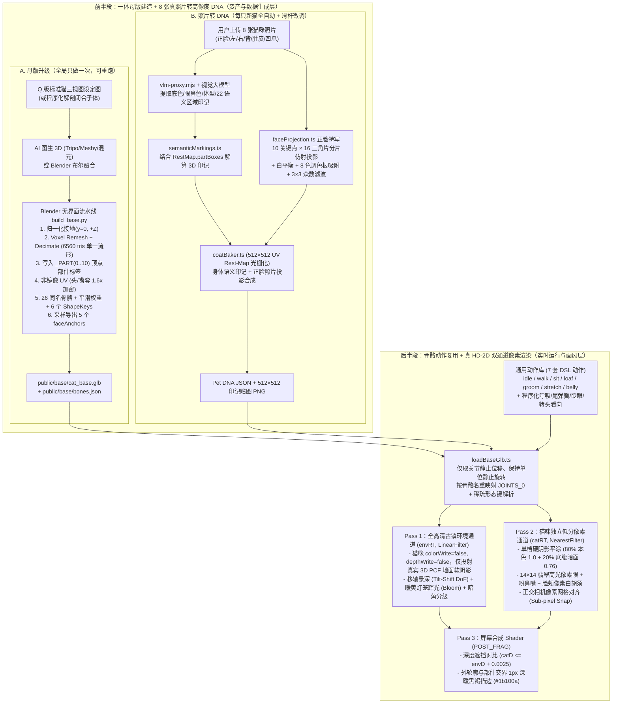

# 喵汪小镇 · 照片生成 HD-2D 猫全链路闭环技术方案（回顾总结与工程规范）

> **核心定位**：将**「前半段：怎么用 Blender/AI 做出一体好造型，并从 8 张真照片自动生成高像度贴图」**与**「后半段：怎么把这只 3D 猫用『场景高清 + 猫单独低分像素层 + 单档平涂硬阴影 + 1px 描边 + 像素胡须』渲出纯正 2D 像素质感」**无缝拼合，形成从**「手机拍 8 张猫咪照片」**到**「古镇里任意方向行走、翻肚皮、3 秒认出自家猫的 HD-2D 像素角色」**的完整工程闭环。

---

## 一、为什么这套「前半段 + 后半段」能彻底闭环？

在迭代过程中，我们先后攻克了两个互不冲突、正交互补的核心难题：

| 阶段 | 解决的核心问题 | 之前的痛点（根因） | 终局工程解法 |
| --- | --- | --- | --- |
| **前半段：母版造型与真照片转 DNA** | 1. 怎么消灭「多球拼装土豆感」？<br>2. 怎么让任意网格都能自动烘焙印记与在线画笔涂色？<br>3. 怎么从 8 张真照片还原出「阴阳嘴套、偏左白火焰、肚皮独立暖橘圆斑」等非对称细节？ | - 代码 `SphereGeometry`/椭球硬拼导致部件交界存在穿插折痕与暗缝；<br>- 旧烘焙器强依赖参数化椭球公式，换真 3D 网格即失效；<br>- 仅靠大模型文字描述无法精准还原正脸毫米级的非对称色块边界。 | 1. **Blender 4.3 无界面一体流形管线（`build_base.py`）**：`Voxel Remesh + Smooth + Decimate` 生成单一水密网格（6,560 三角面）+ `_PART` 顶点标签 + 非镜像 UV + 26 同名骨骼 + 6 形态键 + 5 表面锚点；<br>2. **UV 静止姿态位置图（Rest-Map）**：在 `512×512` UV 空间光栅化三角形，解耦几何来源与花色烘焙；<br>3. **VLM 22 语义区域翻译 + 正脸 10 关键点 16 三角片分片仿射投影**：身体走语义印记，正脸直接投影真照片并做调色板像素化清理。 |
| **后半段：真 HD-2D 分层渲染与像素画着色** | 1. 怎么让 3D 实时渲染的猫拥有纯正手绘 2D 像素立绘质感，同时保留 8 方向自由走动与非对称花色？<br>2. 怎么让古镇场景保持高清锐利，不跟着猫一起变糊？ | - 全屏统一降采样（Downsample）把古镇石板砖缝与灯笼全部糊成马赛克；<br>- 传统 3~4 阶 Toon 卡通着色在圆润 3D 表面产生一圈圈等高线色带，暴露出强烈的「3D 塑料球感」；<br>- 缺少像素级外轮廓收边与脸颊胡须细节。 | 1. **双通道分层 RenderTarget（`envRT` + `catRT`）**：古镇走原生全高清 `envRT`（猫仅关闭 `colorWrite/depthWrite` 参与投射真实 3D 地面软阴影），猫咪单独渲染到低分辨率 `catRT`（`NearestFilter`）；<br>2. **像素画式单档硬阴影平涂（`makePixelFlatGradient`）**：80% 受光面保持 100% 贴图本色，仅底腹背光面压一档 `0.76` 硬阴影；<br>3. **1px 深暖黑褐描边（`#1b100a`）+ 灵动翡翠像素眼 + 3D 贴面像素白胡须**。 |

---

## 二、全链路闭环架构总览



---

## 三、前半段技术细节：Blender 一体母版 + Rest-Map + 照片转 DNA

### 3.1 Blender 4.3 无界面母版管线（`prototype/tools/blender/build_base.py`）

通过 `npm run build:base`（底层调用 `blender -b -P tools/blender/build_base.py`）全自动执行以下 9 个确定性步骤：

1. **双源几何输入与坐标系归一化**：
   - 支持 `--input raw_cat.glb|obj` 导入外部 AI 图生 3D（Tripo / Meshy / 混元 3D）或手工雕刻模型，自动清除杂散材质并按包围盒归一化至地面 `y = 0`、正脸朝 `+Z`、猫自身左侧为 `+X`、身长约 `1.0`；
   - 无外部输入时，自动用解剖级闭合子体（圆润包子头、饱满嘴套、柔顺颈胸过渡、流线躯干、四肢与脚掌、6 节上翘长尾、双耳）执行 `EXACT Boolean Union` 合并。
2. **体素重建与流形减面（`Voxel Remesh + Smooth + Decimate`）**：
   - 使用体素网格重建彻底消除多球体内部穿插面与交界折痕，再经拉普拉斯平滑与减面收敛至 **3,811 顶点 / 6,560 三角面**，100% 法线朝外，形成脖子、脸颊、嘴套、躯干与四肢完全连续的单一水密网格。
3. **解剖部件顶点标签 `_PART`（`0..10`）**：
   - 为每个顶点写入 `FLOAT` 自定义属性 `_PART`（`0: head, 1: muzzle, 2: neck, 3: body, 4: fLegL, 5: fLegR, 6: hLegL, 7: hLegR, 8: earL, 9: earR, 10: tail`），随 glTF 原生导出，供运行时 UV 烘焙与画笔跨部件隔离使用。
4. **非镜像高密度 UV 展开**：
   - **严禁左右镜像**：11 个部件各自拥有独立 UV 岛；
   - 针对 `512×512` 图集（`ATLAS_SIZE = 512`），将头部（`256×128`）与嘴套（`128×64`）的 UV 采样面积放大至 **1.6 倍**，确保「左唇下窄浅杏棕弧边」「右嘴套焦糖斑与胡须点」「鼻梁偏左白火焰」等毫米级非对称细节在近景与中景下均不糊成色块。
5. **同名 26 根骨骼层级与 `bones.json` 导出**：
   - 严格按照 `prototype/src/cat/skeleton.ts` 的 26 根骨骼名与父子层级生成骨架，并导出 `prototype/public/base/bones.json` 世界坐标表。
6. ** Hermite 平滑蒙皮权重**：
   - 对头颈、肩胸、臀腿及 6 节尾骨链计算平滑过渡权重（每顶点最多 4 骨骼影响并归一化），保证大幅度动作（如 `belly` 翻肚皮、`stretch` 伸懒腰、`groom` 舔爪）无撕裂、无折瘪。
7. **6 个标准体型形态键（ShapeKeys / MorphTargets）**：
   - 基于 `_PART` 掩码生成 `headRound`（圆脸）、`weight`（肥瘦/肚腩）、`earSize`（耳大小）、`tailFluff`（蓬松尾）、`cheekFluff`（发腮）、`muzzleSize`（嘴套饱满度）6 个相对位移形态键，随 GLB 导出。
8. **表面五官锚点采样（`faceAnchors`）**：
   - 在头部与嘴套前表面自动射线/最近点采样 `eyeL, eyeR, mouth, whiskerL, whiskerR` 5 个锚点的 `{ vertexIndex, pos, normal }`，写入 glTF `extras.faceAnchors`。
9. **一键产物输出**：
   - 输出 `prototype/public/base/cat_base.glb`（约 460KB）与 `assets/cat_base.glb`。

---

### 3.2 运行时 GLB 加载与「零改动作库」骨骼桥接（`loadBaseGlb.ts`）

为了让 Blender 导出的任意新母版网格直接复用现有的 **7 套关键帧 DSL 动作**而不发生关节扭曲，`prototype/src/cat/loadBaseGlb.ts` 采用了**「仅取关节静止位移、保持单位静止旋转」**的核心设计：

- **节点树静止世界坐标提取**：遍历 glTF `nodes` 树累加 `translation` 得到每根同名骨骼的静止世界位置 `bonePositions`，传入 `createSkeleton(bonePositions)`；
- **单位静止四元数约定**：运行时骨骼在 Bind Pose 下的局部旋转恒为单位四元数 `Identity (0, 0, 0, 1)`，局部坐标轴与世界轴严格对齐（`+X` 低头/后摆、`+Y` 左转、`+Z` 右歪头），因此 `prototype/src/anim/clips/*.ts` 中的全部 7 个动作无需改动任何一行代码即可驱动新网格；
- **`JOINTS_0` 按名重映射与稀疏 MorphTarget 解析**：按骨骼名称把 glTF skin 的 `JOINTS_0` 索引重映射为运行时 `sk.index[boneName]`，并完整支持 Blender glTF 导出的 Sparse MorphTarget Accessor；
- **五官锚点随体型自适应**：`FaceRig.applyShape(k)` 读取 `faceAnchors` 中绑定的 `vertexIndex`，在形态键权重变化时实时累加 `geo.morphAttributes.position` 的顶点位移差，保证胖橘、瘦奶牛猫、圆脸咪咪的眼睛、鼻嘴与胡须永远紧贴网格表面不悬空、不陷落。

---

### 3.3 512×512 UV 静止姿态位置图烘焙（`coatBaker.ts`：`buildRestMap`）

当母版从「参数化椭球」升级为「Blender 任意一体网格」后，印记烘焙器不再使用反三角函数参数反算，而是改为 **UV 空间三角形光栅化（Rest-Pose Position Map）**：

1. **光栅化静止网格**：遍历 `cat_base.glb` 的全部三角形，在 `512×512` UV 空间用重心坐标插值每个纹素（Texel）的静止 3D 世界坐标 `pos (x, y, z)`、表面法线 `norm (nx, ny, nz)` 与部件编号 `partId (0..10)`；
2. **4 轮 UV 岛边缘外扩（Dilation Padding）**：对 UV 岛边界外侧空白纹素执行 4 轮邻域有效纹素扩展，彻底杜绝采样时在 UV 缝合处出现黑线或底色漏边；
3. **自动统计各部件 3D 包围盒 `partBoxes`**：在生成 `RestMap` 时同步计算出 11 个解剖部件的真实 3D 包围盒 `{ min, max, center, size }`，供后续语义印记翻译器自动定位，无需手写魔法坐标；
4. **3D 画笔按部件裁切（`paint.ts`）**：在线「在猫身上绘制」工具直接读取 `RestMap.partId`，笔刷落在左前腿时绝不会越界污染胸口或右前腿。

---

### 3.4 8 张真照片转结构化 DNA + 正脸关键点分片仿射投影（`prototype/src/photo/`）

每只猫的花色生成采取**「身体走 VLM 语义印记 + 正脸走真照片分片仿射投影」**的双保险融合策略：

1. **8 张照片结构化抽取与 22 语义区域翻译（`vlm-proxy.mjs` + `semanticMarkings.ts`）**：
   - 本地代理将用户上传的 8 张照片（正脸特写、俯视背脊、左侧、右侧、翻肚皮、四肢爪子）发给 OpenAI 兼容视觉大模型，提示词强制规定**「左右 = 猫自身的左右（画面左侧为猫右侧 `-X`）」**；
   - `semanticMarkings.ts` 将输出的结构化语义区域（涵盖 `forehead.m_tabby`、`nose_bridge.blaze_left`、`muzzle.right`、`muzzle.left_lip`、`chin`、`chest.bib`、`belly.base`、`belly.center_spot`、`flank.left`、`flank.right`、`paw.frontLeft.sock`、`paw.frontRight.inner_wrist`、`paw.hindLeft.tabby_shorts`、`paw.hindLeft.ankle_sock` 等 **22 个解剖语义槽位**）结合 `RestMap.partBoxes` 自动翻译为 `part / underside / stripes / blob` 3D 印记列表。
2. **正脸特写 10 关键点 × 16 三角片分片仿射投影（`faceProjection.ts`）**：
   - 针对最具辨识度的正脸（如咪咪的「阴阳嘴套」与「偏左眼通鼻白火焰」），检测或标定正脸照片上的 **10 个关键点**（`eyeL, eyeR, noseTip, mouthCenter, whiskerL, whiskerR, foreheadTop, chinBottom, cheekL, cheekR`）；
   - 将这 10 个 2D 关键点与母版 3D 表面对应的 10 个基准点连成 **16 个无缝拼接的德劳内三角片（Piecewise Affine Mesh）**；
   - 遍历 `RestMap` 中属于 `head` 或 `muzzle`、且法线朝前（`norm.z > 0.15`）的每一个 UV 纹素，通过重心坐标逆映射到正脸照片像素；
   - **光照净化与像素化**：用 `chinBottom` 与 `nose_bridge` 高亮区自动做白平衡消除室内黄光偏色，再将采样颜色按感知色差吸附到该猫专属的 **8 色调色板**，最后经 **2 轮 `3×3` 邻域众数滤波（Mode Filter）**消除照片噪点，输出干净锐利的像素级正脸贴图。

---

## 四、后半段技术细节：真 HD-2D 双通道分层渲染 + 像素平涂着色

要让这只带完整骨骼与非对称贴图的 3D 猫在画面中呈现出《八方旅人》式的纯正 2D 像素质感，后半段渲染管线（`prototype/src/render/pixelPipeline.ts`、`buildCat.ts`、`face.ts`）做了四项决定性改造：

### 4.1 双通道分层 RenderTarget（高清古镇 + 独立低分像素猫）

摒弃了早期「全屏一起降分辨率导致场景变糊」的做法，改为三阶段复合管线：

- **Pass 1：全高清古镇环境通道（`envRT`，原生窗口分辨率，`LinearFilter`）**
  - 渲染前临时将猫咪 `cat_actor_group` 的所有材质设为 `colorWrite = false`、`depthWrite = false`，但保持 `castShadow = true`；
  - 效果：古镇青石拱桥、水面波光、木栏杆、暖黄灯笼与樱花树保持 **100% 原生全高清锐利度**，同时**猫咪在高清石桥地面上投下真实的 3D 柔和阴影（PCFSoftShadowMap）**，实现像素角色与 3D 空间的物理接地融合；
  - 环境后处理叠加电影级移轴景深（`Tilt-Shift DoF`，远近端散景虚化、中央石桥区锐利）、暖黄灯笼柔光辉散（`Bloom`）与江南夜色暗角分级。
- **Pass 2：猫咪独立低分辨率像素通道（`catRT`，`分辨率 = 窗口 / pixelScale`，`NearestFilter`）**
  - 隐藏环境几何体（保留全部场景光源），背景清为全透明（`alpha = 0`），仅将猫咪渲染到低分辨率 `catRT` 并记录低分深度 `tCatDepth`；
  - 正交相机执行**亚像素网格对齐（Sub-pixel Camera Snap）**：相机跟随猫咪移动时自动按 `pixelWorld` 步长吸附，彻底消除像素角色走动时的边缘闪烁（Pixel Creep）。
- **Pass 3：深度感知合成与 1px 描边（`POST_FRAG`）**
  - 在屏幕合成 Shader 中对比 `catD <= envD + 0.0025`，正确处理古镇前景石栏杆对猫咪的 3D 空间遮挡。

### 4.2 像素画式单档硬阴影平涂（告别 3D 球面等高线色带）

在 `prototype/src/cat/buildCat.ts` 的 `makePixelFlatGradient()` 中：

- 构造 `32×1` 的 `NearestFilter` 一维色阶表：前 `20%`（`i < 6`，对应底腹、下巴底面与腿根内侧大角度背光区）取单档硬阴影系数 **`0.76`（`194/255`）**，其余 **`80%` 受光面统一保持 `1.0`（`255/255` 贴图本色）**；
- 彻底消除了传统 3~4 阶 Toon 着色在圆头和身体上切出的「一圈圈球面色带」，让 512×512 贴图上的虎斑、白袜与阴阳嘴套像纯正 2D 手绘像素画一样干净通透。

### 4.3 1px 深暖黑褐描边（`#1b100a`）+ 部件内部分界线

在 `POST_FRAG` 中对 `catRT` 进行像素级轮廓提取：

- **外轮廓 1px 描边**：当当前像素为背景，但其 4-邻域（或至少 2 个对角邻域）存在可见猫体像素时，直接输出 `1px` 深暖黑褐描边色 `#1b100a`（`vec3(0.106, 0.063, 0.039)`），比纯黑更融入暖调古镇；
- **内部部件深度跃变线**：当猫体像素内部相邻纹素的归一化深度差 `(catD - nd) * depthRange > 0.14`（例如前腿迈步跨过后腿、下巴叠在胸前围脖上方）时，自动混入同色系 1px 内部分界线，使四肢交叠动作层次分明。

### 4.4 灵动像素五官贴片与 3D 贴面像素白胡须（`face.ts`）

- **14×14 翡翠高光像素眼（`EYE_ART`）**：包含深褐眼线外框 `k`、深翠外虹膜环 `r`、翡翠主虹膜 `i`（`#8fb369`）、下沿亮翠月牙反光 `g`、竖瞳 `p` 与左上双格纯白高光 `w`，支持 `open / closed / happy / sleepy / surprised` 5 态切换；
- **13×10 砖红粉鼻与嘴线（`MOUTH_ART`）**：包含砖红粉鼻主色 `#c85a48`、鼻尖高光与 W 形像素嘴线，支持 `closed / open / tongue`（舔毛吐舌）；
- **12×8 贴面像素白胡须（`WHISKER_ART`）**：左右脸颊锚点（`whiskerL / whiskerR`）各挂载一块紧贴脸颊曲面的像素胡须面片（两根纯白像素胡须 `#ffffff` 配深褐衬底 `#231710`），无论正脸还是 3/4 侧面行走，都能看到鲜明的像素白胡须。

---

## 五、全套文件清单与常用命令速查

### 5.1 核心代码与工具地图

| 模块 | 路径 | 职责说明 |
| --- | --- | --- |
| **Blender 母版生成脚本** | `prototype/tools/blender/build_base.py` | 无界面生成/转换 `cat_base.glb`（一体流形网格、`_PART`、非镜像 UV、26 骨骼、6 形态键、5 锚点） |
| **母版 GLB 与骨骼坐标** | `prototype/public/base/cat_base.glb`<br>`prototype/public/base/bones.json` | 导出的标准一体母版资产与 26 骨骼静止世界坐标表 |
| **运行时 GLB 加载器** | `prototype/src/cat/loadBaseGlb.ts` | 解析 GLB、仅取关节位移保留单位旋转、重映射 `JOINTS_0`、解析稀疏形态键与 `faceAnchors` |
| **UV 位置图与印记烘焙** | `prototype/src/cat/coatBaker.ts` | `buildRestMap` 光栅化 512×512 UV 位置/法线/部件图与 `partBoxes`，合成语义印记与正脸投影 |
| **22 语义区域翻译器** | `prototype/src/photo/semanticMarkings.ts` | 将 VLM 抽取的 22 个解剖区域自动映射为基于 `RestMap.partBoxes` 的 3D 印记 |
| **正脸分片仿射投影** | `prototype/src/photo/faceProjection.ts` | 10 关键点 × 16 三角片分片仿射映射、自动白平衡、8 色调色板吸附、3×3 众数滤波 |
| **VLM 本地抽取代理** | `prototype/server/vlm-proxy.mjs` | 转发 8 张照片至 OpenAI 兼容视觉大模型并按 JSON Schema 返回结构化 DNA |
| **像素五官与胡须** | `prototype/src/cat/face.ts` | 14×14 像素眼、鼻嘴、脸颊像素白胡须及形态键顶点位移自适应 |
| **HD-2D 双通道渲染管线** | `prototype/src/render/pixelPipeline.ts` | `envRT` 全高清古镇 + 真实 3D 阴影、`catRT` 独立低分像素猫、1px 描边与移轴景深合成 |
| **7 套通用动作库** | `prototype/src/anim/clips/*.ts` | `idle, walk, sit, loaf, groom, stretch, belly`（全猫零改动通用） |

### 5.2 常用命令与 URL 调试参数

```bash
cd prototype

# 1. 重新运行 Blender 无界面母版生成流水线（产出 public/base/cat_base.glb 与 bones.json）
npm run build:base
# 若有外部 AI 生成或手工雕刻的白模：
blender -b -P tools/blender/build_base.py -- --input /path/to/raw_cat.glb

# 2. 启动本地 VLM 照片抽取代理（需设置 OPENAI_API_KEY，支持通义千问 VL / 豆包 / GPT-4o）
OPENAI_API_KEY=sk-xxx npm run vlm-proxy

# 3. 启动前端开发服务器
npm run dev

# 4. 运行三层解耦架构自动门禁（验证 7 动作 × 3 只猫 = 21 组合零耦合）与生产构建
npm run check
npm run build
```

**常用 URL 预览参数**：
- 默认一体母版（Blender GLB）：`https://xuzhenhao.github.io/miaowangtown/`
- 参考图同机位对比视角：`https://xuzhenhao.github.io/miaowangtown/?preset=compare`
- 切换旧版程序化几何对比：`https://xuzhenhao.github.io/miaowangtown/?base=procedural`
- 指定猫咪与动作：`?pet=mimi|juzi|nainiu&action=idle|walk|sit|loaf|groom|stretch|belly`

---

## 六、端到端验证图集索引（`docs/validation/`）

1. **前后半段总览与真照片对比评估图**：`docs/validation/blender_vs_procedural_evaluation.png`
2. **8 张真照片 -> UV Rest-Map + 正脸投影 -> 4 角度实机渲染全链路图**：`docs/validation/photo_to_dna_pipeline_demo.png`
3. **单一 Blender 母版跨猫复用验证（咪咪 / 橘座 / 奶牛）**：`docs/validation/three_cats_on_blender_rig.png`
4. **Q 版标准母版猫三视图设定图（正 / 左 / 右）**：`docs/validation/q_cat_turnaround_sheet.png`
